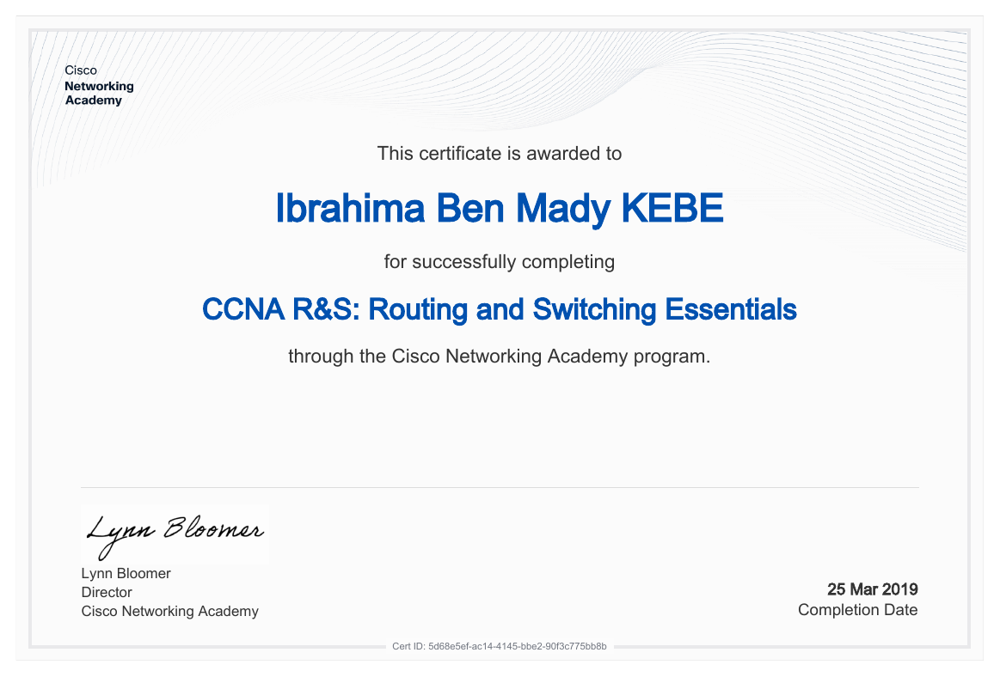

 

**[À propos](#apropos) · [Compétences](#competences) · [Certifications](#certifications) · [Projets](#projets) · [Parcours](#parcours) · [Contact](#contact)**

**[🌐 Voir mon portfolio en ligne](https://benmadykebe-cloud.github.io/Ibrahima-Ben-Mady-Kebe/)**

 

Formé en **informatique appliquée à la gestion** et titulaire d'un **MBA**, je combine une base technique solide (systèmes, réseaux, données) avec une expérience concrète en **coordination d'opérations**, en **analyse de dossiers** et en **soutien administratif**.

Je comprends autant le côté technique d'un problème que son impact sur l'équipe, le client et le budget. J'aime analyser un processus, repérer ce qui coince et le rendre plus fluide.

<b>🎯 Ce que je recherche</b>

 

- 🔧 **Support TI** : technicien informatique, centre de services
- 🌐 **Réseau** : technicien réseau junior, opérations réseau
- 📋 **Coordination de projets TI** : là où la technique rencontre la gestion
- 📊 **Données et opérations** : analyse, saisie, validation, rapports

<b>💡 Mon double profil</b>

 

| Côté technique | Côté gestion |
|---|---|
| Réseaux Cisco, systèmes, dépannage | MBA, suivi de projets, calendriers |
| Données, Excel avancé, rapports | Coordination d'équipes, relation client |
| Documentation rigoureuse | Analyse de dossiers et de processus |

 

<b>🌐 Réseautique</b>

 

 

- Modèles OSI et TCP/IP, adressage **IPv4/IPv6** et sous-réseaux
- Configuration de routeurs et de commutateurs Cisco en ligne de commande
- Routage statique et dynamique (OSPF), **EtherChannel**, **HSRP**
- Services réseau : DHCP, NAT, listes de contrôle d'accès

<b>💻 Support et systèmes</b>

 

- Assemblage, diagnostic et dépannage de matériel informatique
- Installation et configuration de systèmes d'exploitation
- Assistance aux utilisateurs, du premier contact à la résolution

<b>📊 Données et bureautique</b>

 

- Saisie, validation et compilation de données avec rigueur
- Production de rapports et de présentations pour la direction
- Mise à jour de systèmes de gestion d'inventaire et de suivi

<b>🤝 Gestion et coordination</b>

 

- Suivi de projets, calendriers, feuilles de temps et livrables
- Coordination d'équipes multidisciplinaires
- Rédaction de correspondances, rapports et mémos
- Collaboration avec les départements crédit, comptabilité, entrepôt et livraison

 

<table>
<tr>
<td align="center" width="33%">

 <b>IT Essentials</b> PC Hardware and Software · Avril 2018
</td>
<td align="center" width="33%">

 <b>CCNA R&amp;S</b> Introduction to Networks · Juin 2018
</td>
<td align="center" width="33%">

 <b>CCNA R&amp;S</b> Routing and Switching Essentials · Mars 2019
</td>
</tr>
</table>

Attestations de cours délivrées par Cisco Networking Academy. Clique sur une image pour l'agrandir.

<b>📘 Détail des acquis par certification</b>

 

| Certification | Ce que j'ai appris |
|---|---|
| **IT Essentials** | Matériel, systèmes d'exploitation, dépannage de premier niveau, notions de sécurité |
| **Introduction to Networks** | OSI/TCP-IP, IPv4/IPv6, sous-réseaux, Ethernet, configuration initiale Cisco |
| **Routing and Switching Essentials** | VLAN, trunk, inter-VLAN, OSPF, STP, EtherChannel, DHCP, NAT, ACL, HSRP |

 

> Chaque projet explique le problème de départ, la démarche et le résultat.

<!-- À REMPLACER : remplace benmadykebe-cloud et NOM-DU-DEPOT par tes vrais liens et ajuste chaque description. Supprime les blocs dont tu n'as pas encore de projet. -->

<b>☕ Java et SQL</b>

 

| Projet | Description | Technologies |
|---|---|---|
| [**Centre de services TI**](https://github.com/benmadykebe-cloud/centre-services-ti) | Application console de gestion de tickets de support et de parc informatique : règles de statut, base SQLite et six rapports SQL (jointures, regroupements, fonction de fenêtre). | `Java 17` `SQL` `SQLite` `JDBC` `Maven` `JUnit 5` |

<b>📊 Gestion et analyse (MBA)</b>

 

| Projet | Description | Technologies et méthodes |
|---|---|---|
| [**Projet d'intégration : gestion des stocks hôteliers**](https://benmadykebe-cloud.github.io/Ibrahima-Ben-Mady-Kebe/#projet) | Rapport de 52 pages (MBA 8948) : diagnostic des ruptures et des surplus dans un hôtel montréalais, plan d'action (ERP relié au système hôtelier, prévision par IA, RFID, stock géré par le fournisseur), indicateurs de suivi et budget estimatif. | `ERP` `PMS` `KPI` `Analyse de processus` `Budget` |
| [**Projet intégrateur : gestion des uniformes médicaux (HGJ)**](https://benmadykebe-cloud.github.io/Ibrahima-Ben-Mady-Kebe/#projet-hgj) | Projet d'équipe de quatre (MBA, automne 2022) : analyse du processus de distribution des scrubs à l'Hôpital général juif de Montréal (Ishikawa, cinq pourquoi), puis comparaison de trois solutions et combinaison retenue d'armoires et de carrousel RFID. | `RFID` `Traçabilité` `Logistique hospitalière` `Analyse des causes` |

<b>🌐 Réseau</b>

 

| Projet | Description | Technologies |
|---|---|---|
| [**Nom du projet réseau**](https://github.com/benmadykebe-cloud/NOM-DU-DEPOT) | *[1 phrase : ce que tu as conçu ou configuré, ex. réseau multi-VLAN avec routage inter-VLAN.]* | `Cisco` `VLAN` `OSPF` |
| [**Nom du second projet réseau**](https://github.com/benmadykebe-cloud/NOM-DU-DEPOT) | *[1 phrase sur l'objectif et le résultat.]* | `NAT` `ACL` `STP` |

<b>📊 Données et automatisation</b>

 

| Projet | Description | Technologies |
|---|---|---|
| [**Nom du projet données**](https://github.com/benmadykebe-cloud/NOM-DU-DEPOT) | *[1 phrase : quel processus tu as simplifié ou quel rapport tu as automatisé.]* | `Excel` `Analyse` |

<b>🏨 Opérations et gestion</b>

 

| Projet | Description | Technologies |
|---|---|---|
| [**Optimisation des opérations, projet UQAM / Hôtel Monville**](https://github.com/benmadykebe-cloud/NOM-DU-DEPOT) | *[Résumé non confidentiel : suivi de projet, compilation de données pour rapports, livrables validés.]* | `Gestion de projet` |

 

<b>📦 Analyste traitement et entrée de données</b> · Magna Stainless et Aluminium · <i>Fév. – Juin 2026</i>

 

- Traitement et saisie de données avec maintenance rigoureuse de l'information
- Réception de l'inventaire et vérification quotidienne de la conformité
- Mises à jour quotidiennes des systèmes de gestion d'inventaire et de suivi
- Collaboration avec crédit, comptabilité, entrepôt et livraison

<b>📈 Analyste projet, optimisation des opérations</b> · Projet UQAM / Hôtel Monville · <i>Jan. – Juil. 2025</i>

 

- Suivi administratif de projets hôteliers et gestion documentaire
- Compilation de données pour des rapports détaillés
- Création de présentations pour le soutien à la direction
- Gestion des calendriers, des feuilles de temps et validation des livrables

<b>🏨 Événementiel banquet</b> · Hôtel Monville · <i>Juin 2022 – Mars 2026</i>

 

- Gestion administrative d'événements corporatifs complexes
- Coordination d'équipes multidisciplinaires, horaires et feuilles de temps
- Rédaction de correspondances, rapports et mémos d'opérations
- Soutien aux directeurs et superviseurs

<b>🏦 Analyste crédit junior</b> · Bank of Africa · <i>Sept. 2021 – Mai 2022</i>

 

- Analyse de dossiers clients et montage de dossiers de crédit
- Vérification de l'exactitude des informations critiques
- Collaboration avec les équipes internes pour la validation des dossiers

<b>🎓 Formation</b>

 

| Diplôme | Période |
|---|---|
| **MBA**, Master of Business Administration | 2022 – 2025 |
| **Bac.** en informatique appliquée à la gestion | 2017 – 2020 |

 

Un poste, une mission, une question technique ? Écris-moi.

<!-- À REMPLACER : ton vrai lien LinkedIn -->

<!-- OPTIONNEL : décommente ce bloc quand ton nom d'utilisateur GitHub est en place et que tu as des dépôts publics.

-->

 

