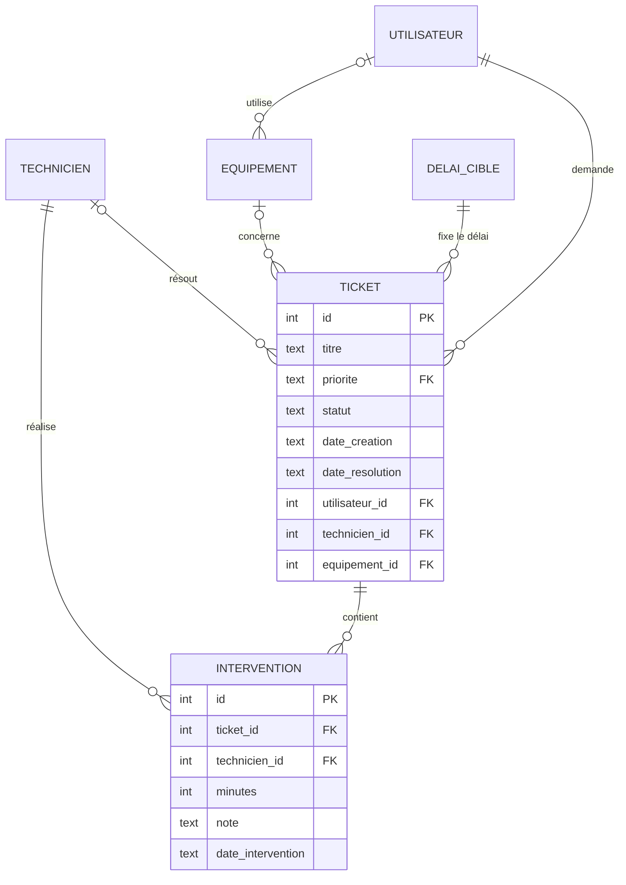
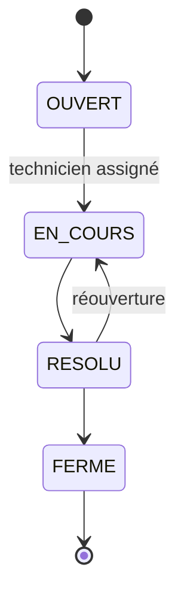

# Centre de services TI


Application Java en ligne de commande qui gère les **tickets de support**, le **parc d'équipements** et les **interventions** d'un petit service informatique, avec des **rapports SQL** pour piloter l'activité.

C'est un projet personnel. Il part d'une question simple : comment un service TI sait-il où il perd du temps ? Les tickets et les équipements viennent du terrain, les rapports répondent à la gestion : quels équipements tombent en panne, quel technicien est surchargé, quels tickets dépassent leur délai.

---

## Ce que fait l'application

```
1. Créer un ticket
2. Lister les tickets
3. Assigner un technicien
4. Changer le statut d'un ticket
5. Ajouter une intervention
6. Voir les interventions d'un ticket
7. Rapports
0. Quitter
```

- Un ticket a une **priorité** (basse, normale, haute, critique), un demandeur, un technicien et, au besoin, un équipement concerné.
- Le **statut** suit un cycle précis (voir plus bas). Le programme refuse les passages interdits.
- Chaque **intervention** enregistre le temps passé par le technicien assigné.

## Les rapports SQL

Chaque rapport est un fichier `.sql` dans [`src/main/resources/rapports`](src/main/resources/rapports), lisible et modifiable sans toucher au Java.

| Rapport | Question à laquelle il répond | Notions SQL |
|---|---|---|
| Tickets ouverts par priorité | Où sont les urgences ? | `GROUP BY`, `CASE` dans `ORDER BY` |
| Délai moyen de résolution | Quel technicien résout le plus vite ? | `JOIN`, `AVG`, `julianday` |
| Équipements les plus en panne | Quel matériel faut-il remplacer ? | `JOIN`, `COUNT`, `LIMIT`, tri stable |
| Charge sur 7 jours | Qui dépasse un seuil d'heures ? | `HAVING`, requête paramétrée |
| Tickets en retard | Quels tickets dépassent leur délai cible ? | `JOIN` sur table de délais, calcul de dates |
| Tickets par département | Quels services demandent le plus d'aide ? | fonction de fenêtre `SUM(COUNT(*)) OVER ()` |

### Exemples de sortie

Sur les données d'exemple fournies :

```
Délai moyen de résolution par technicien
+--------------+-----------------+-----------------+
| Technicien   | Tickets résolus | Délai moyen (h) |
+--------------+-----------------+-----------------+
| Sofia Gagnon | 2               | 6.5             |
| Alex Roy     | 5               | 7.2             |
| Karim Diallo | 2               | 9.0             |
+--------------+-----------------+-----------------+

Équipements les plus souvent en panne
+------------+-----------------+---------+
| Type       | Numéro de série | Tickets |
+------------+-----------------+---------+
| IMPRIMANTE | IMP-2020-002    | 3       |
| PORTABLE   | LT-2023-001     | 2       |
| POSTE      | PC-2021-014     | 2       |
| ROUTEUR    | RT-2021-001     | 2       |
| PORTABLE   | LT-2023-002     | 1       |
+------------+-----------------+---------+

Tickets en retard sur leur délai cible
+----+----------------------------------------------+----------+---------+-----------------+
| N° | Titre                                        | Priorité | Âge (h) | Délai cible (h) |
+----+----------------------------------------------+----------+---------+-----------------+
| 6  | Ports hors service sur le commutateur de ... | CRITIQUE | 6.0     | 4               |
| 16 | Connexion VPN impossible en télétravail      | NORMALE  | 26.0    | 24              |
+----+----------------------------------------------+----------+---------+-----------------+
```

Les dates du jeu d'exemple sont calculées à partir de l'heure du chargement : les âges des tickets en retard changent donc avec le temps.

---

## Lancer le projet

**Prérequis :** JDK 17 ou plus récent, et Maven 3.9 ou plus récent. La base SQLite est un simple fichier : rien d'autre à installer.

Télécharge ou clone le dépôt, puis dans le dossier du projet :

```bash
mvn test                                    # lance les tests
mvn package                                 # construit target/centre-services-ti.jar
java -jar target/centre-services-ti.jar --demo
```

- `--demo` charge les données d'exemple (8 utilisateurs, 3 techniciens, 12 équipements, 16 tickets) la première fois.
- `--base fichier.db` choisit le fichier de base de données (par défaut `centre_ti.db`, créé dans le dossier courant).
- Sans `--demo`, la base démarre vide.

Sous Windows, si les accents s'affichent mal dans le terminal, lance d'abord `chcp 65001`.

---

## Modèle de données



Le schéma complet, avec ses contraintes, est dans [`schema.sql`](src/main/resources/schema.sql).

## Règles de gestion



- Un ticket ne peut pas être pris en charge sans technicien.
- Une intervention ne s'ajoute que sur un ticket **en cours**, par le technicien **assigné**, avec une durée supérieure à zéro.
- La date de résolution existe si et seulement si le ticket est résolu ou fermé. Une réouverture l'efface.

Ces règles sont vérifiées **deux fois** : dans le code Java (messages clairs pour l'utilisateur) et dans la base elle-même, avec des contraintes `CHECK` et des clés étrangères. Même une requête SQL écrite à la main ne peut pas créer un état incohérent.

---

## Architecture

```
src/main/java/ca/kebe/centreti/
├── Main.java               point d'entrée et options en ligne de commande
├── model/                  objets du domaine (Ticket, Statut, Priorite, Rapport)
├── db/Database.java        connexion SQLite, création du schéma, chargement des données
├── dao/                    accès à la base : tout le SQL passe par des PreparedStatement
├── service/TicketService   règles de gestion (transitions de statut, validations)
└── ui/                     menu console et mise en forme des tableaux

src/main/resources/
├── schema.sql              tables, contraintes, index
├── donnees-exemple.sql     données fictives pour essayer l'application
└── rapports/*.sql          les six rapports

src/test/java/              tests JUnit 5 sur une base SQLite en mémoire
```

Chaque couche a un rôle : l'interface affiche, le service décide, les DAO parlent à la base. Le service n'écrit aucun SQL et l'interface ne contient aucune règle de gestion.

### Choix techniques

- **SQLite et JDBC** : une base en un seul fichier, sans serveur à installer, avec le vrai pilote JDBC. Passer à PostgreSQL ou MySQL ne demande que de changer l'URL et le pilote.
- **Requêtes préparées partout** : aucune valeur saisie n'est collée dans une requête, ce qui évite l'injection SQL.
- **SQL dans des fichiers** : les rapports se lisent, se testent et se modifient sans recompiler.
- **Dates en UTC** : les dates sont stockées au format `AAAA-MM-JJ HH:MM:SS` en UTC, pour éviter les écarts de fuseau horaire.

## Tests

`mvn test` exécute 23 tests JUnit 5 :

- les transitions de statut autorisées et interdites ;
- le cycle de vie complet d'un ticket, la réouverture et les refus du service ;
- le refus d'un état incohérent directement par la base ;
- les six rapports, vérifiés sur les données d'exemple ;
- la mise en forme des tableaux.

## Pistes d'amélioration

- Une interface web (Spring Boot) ou JavaFX au-dessus des mêmes services.
- Un export des rapports en CSV pour les ouvrir dans Excel.
- Une migration vers PostgreSQL, avec Flyway pour versionner le schéma.
- Une table d'historique pour tracer chaque changement de statut.
- Des délais cibles qui tiennent compte des heures ouvrables.

---

## Auteur

**Ibrahima Ben Mady Kebe**, Montréal, QC. Formation en informatique appliquée à la gestion, MBA, certifications Cisco Networking Academy (IT Essentials, CCNA R&S).

Projet distribué sous licence MIT (voir [`LICENSE`](LICENSE)). Les personnes et équipements des données d'exemple sont fictifs.
